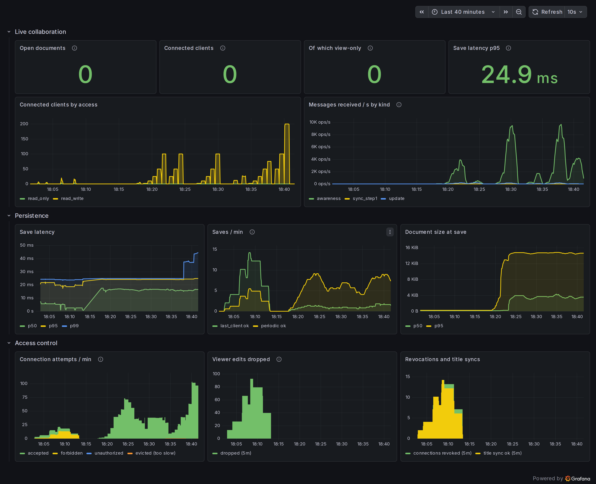

# Load test: how many people can edit one note?

The editor service keeps one in-memory Yjs document per open note and relays every keystroke and cursor move to everyone else in the room. This test measures how that holds up as a room grows, from 2 to 200 clients. It found two bugs that brought delivery for a 50-person room down to 36 %. Both are now fixed.



## Method

[`tests/load/collab-load.mjs`](../../tests/load/collab-load.mjs) simulates collaborators that behave like the browser editor:

- Each client is a real `Y.Doc` synced through `y-websocket`, connecting to `wss://…/ws/{note}` **through nginx** with its own session cookie. That means it goes through the full path: TLS, the `auth_request` check, the editor's access check, then the room.
- Each typing client writes into its own paragraph of the ProseMirror fragment at 5 keystrokes/s, which is fast typing. After every keystroke it sends a cursor (awareness) update, as TipTap's caret extension does.
- **Latency is measured end to end.** Every writer has a fixed Yjs client ID. When any client receives an update, it decodes the struct ID (client, clock) and looks up the moment that character was typed in a table shared between threads. Each keystroke is therefore measured once for each of the other N − 1 clients.
- **Delivered** is the share of the expected keystroke deliveries (keystrokes × (N − 1)) that arrived before the step ended.
- Clients run across 16 worker threads so the load generator isn't the bottleneck. "Generator lag" is the p99 event-loop delay of those threads. When it climbs past about 100 ms, the generator is overloaded and the row measures it, not the server.
- Each step uses a fresh note and runs for 30 s. CPU and memory come from `docker stats` halfway through each step.

Everything ran on one laptop (i7-13700H, 20 threads, 16 GB): the full Docker stack and the load generator together, through the `make demo` setup. The raw results are in [`load-test-results/`](load-test-results/).

```bash
make demo
make load                                                # the "everyone types" ramp below (2..50 clients)
cd tests/load                                            # options are documented at the top of collab-load.mjs
node collab-load.mjs --clients 50,100,200 --active 0.1   # big rooms, one writer in ten
node collab-load.mjs --clients 25 --stalled 2            # plus two clients that stop reading
```

## Before: the room fell apart at 50 people

Everyone typing, cursors on:

| Clients | Keystrokes/s | Delivered | Latency p50 / p95 / p99 | editor CPU | editor memory |
| ---: | ---: | ---: | --- | ---: | ---: |
| 10 | 50 | 100 % | 3 / 5 / 6 ms | 22 % | 12 MB |
| 25 | 116 | 100 % | 10 / 84 / 146 ms | 64 % | 15 MB |
| **50** | 198 | **36 %** | **11.4 / 20.9 / 22.2 s** | 56 % | **531 MB** |
| **100** | 297 | **18 %** | **8.2 / 22.3 / 25.6 s** | 82 % | **2.9 GB** |

At 50 clients most keystrokes never arrived, and the ones that did were 11–22 s late. Meanwhile the editor's CPU was *lower* than at 25 clients and its memory grew without limit. That pattern means the server was producing data much faster than it could send it.

Running the same test with cursor updates turned off (`--no-cursors`) made 50 clients clean again: 100 % delivered, p50 3 ms. So the cursors were the cause.

### Cause 1: every cursor move re-sent everybody's cursor

On every awareness message, `sync.rs` applied the update and then broadcast `awareness.update()`. That function encodes the state of **every client in the room**, not just the one that moved. With N clients each moving their cursor r times per second:

- each broadcast is O(N) bytes,
- it goes to N − 1 clients,
- and there are N·r of them per second,

for **O(N³) bytes per second**. At 50 clients typing at 5 keystrokes/s that is roughly 50 × 5 × 49 messages/s of about 50 cursor states each, so about 90 MB/s of mostly unchanged cursors.

**Fix:** the server applies the update to its own awareness state, then relays the client's original message, which contains only that client's state. The reference `y-websocket` server does the same. Each broadcast is now O(1) and the total is O(N²), the minimum for "everyone sees everyone". The unit test `cursor_moves_relay_only_the_sender_state` covers it; it fails on the old code.

### Cause 2: per-client queues had no limit

Each connection had an `mpsc::unbounded_channel` feeding its socket. When a client reads slower than the room produces, the queue simply grows, which is where the 2.9 GB came from. Fixing the cursor storm removed the trigger, but not the risk. **A single client that stops reading its socket, such as a frozen tab or a hostile client, would make the server buffer for it until it runs out of memory.**

**Fix:** the queue is now bounded at 2048 messages, a few seconds of heavy traffic. If a broadcast finds a client's queue full, that client is removed from the room and its socket closed right away. y-websocket reconnects on its own and resyncs the full document through the normal SyncStep1/SyncStep2 handshake, so the client loses nothing. A slow client costs a reconnect, not unbounded memory. Evictions are counted in `editor_clients_evicted_total` and shown on the dashboard.

Verified with `--clients 25 --stalled 2`: both stalled clients were evicted after about 2048 messages, the other 25 still received 100 % with p99 19 ms, and the editor stayed at 10 MB.

## After

Everyone typing, cursors on:

| Clients | Keystrokes/s | Deliveries/s | Delivered | Latency p50 / p95 / p99 | Join p95 | editor CPU | editor memory |
| ---: | ---: | ---: | ---: | --- | ---: | ---: | ---: |
| 2 | 10 | 10 | 100 % | 3 / 4 / 9 ms | 19 ms | 1 % | 8 MB |
| 10 | 50 | 446 | 100 % | 5 / 23 / 37 ms | 40 ms | 16 % | 11 MB |
| 25 | 124 | 2 976 | 100 % | 4 / 14 / 20 ms | 88 ms | 109 % | 12 MB |
| **50** | 247 | 12 101 | **100 %** | **3 / 11 / 23 ms** | 169 ms | 184 % | **17 MB** |
| 75 ¹ | 180 | 13 352 | 100 % | 464 ms / 2.2 s / 2.9 s | 358 ms | 263 % | 29 MB |

Larger rooms, where one client in ten types and the rest read along (a lecture or a meeting):

| Clients | Typing | Deliveries/s | Delivered | Latency p50 / p95 / p99 | Join p95 | editor CPU | editor memory |
| ---: | ---: | ---: | ---: | --- | ---: | ---: | ---: |
| 50 | 5 | 1 215 | 100 % | 6 / 23 / 37 ms | 128 ms | 67 % | 30 MB |
| **100** | 10 | 4 798 | **100 %** | **6 / 31 / 127 ms** | 768 ms | 188 % | **33 MB** |
| 200 ¹ | 20 | 3 906 | 99 % | 0.9 / 4.2 / 7.3 s | 3.9 s | 225 % | 54 MB |

¹ The load generator was overloaded in these rows: its event loop was 0.8–3 s behind, and it sent only about half the planned keystrokes. Each simulated client decodes every update, as a browser does, so 75 typists means about 28 000 deliveries plus as many cursor updates per second, all on the same 20 threads as the server. These rows show where this single machine stops being a valid test bench, not where the editor stops. Going further needs the generator on a second machine.

**In short:** a room of **50 people all typing at once** delivers every keystroke with a **p99 of 23 ms**, and a **100-person room with 10 writers** has a p99 of 127 ms. Editor memory stays under 35 MB in both, where it used to reach 2.9 GB.

## What the numbers suggest next

- **Cost per message.** At 50 typists the editor uses about 1.8 cores to send about 24 000 messages/s (keystrokes plus cursors), roughly 75 µs per delivery. Each broadcast clones the message into every client's queue and is framed per socket. nginx then re-encrypts every frame (it uses about 1.2 cores). Serializing a broadcast once and sharing it (`Bytes`), or batching several updates into one frame per client, are the obvious next steps.
- **Cursor traffic dominates.** On the dashboard, awareness messages outnumber document updates many times over (*Messages received / s by kind*). Throttling cursor broadcasts on the client (one per animation frame is plenty) would cut that traffic, and the matching CPU, by a large factor.
- **Join time at 100+ clients.** Joining takes up to 0.8 s at 100 clients. Each join sends the full document and every client's cursor, and every client also adds a paragraph. That's fine for now, but it's the next thing to watch.
- **Saves are unaffected.** Persistence stayed at about 25 ms p95 throughout (*Save latency*), because saves happen every 5 s per room no matter how many people type.
- **Memory is retained after a spike.** Before the fix, the editor stayed at 3.7 GB after every room had closed. A second run reused that memory instead of growing, so it was the allocator holding on to the peak, not a leak. With bounded queues the peak itself is small.
