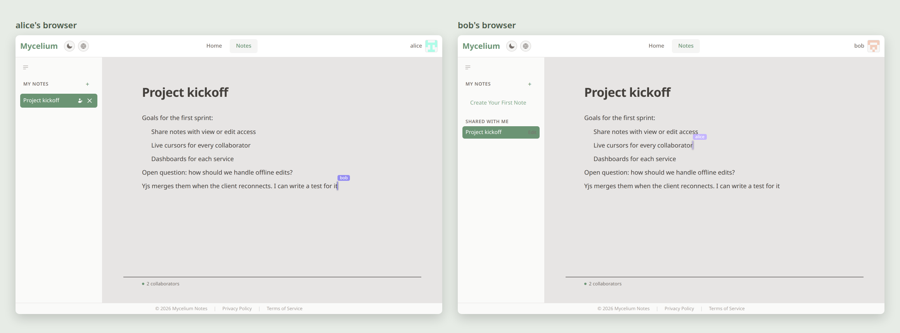
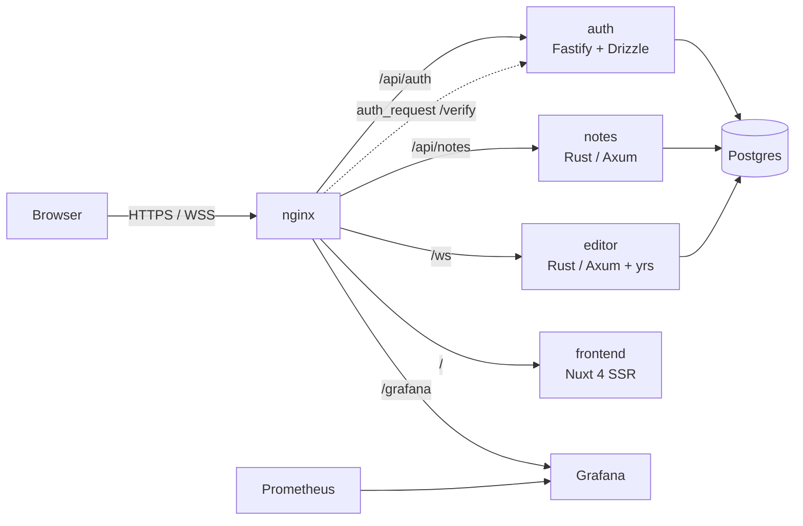
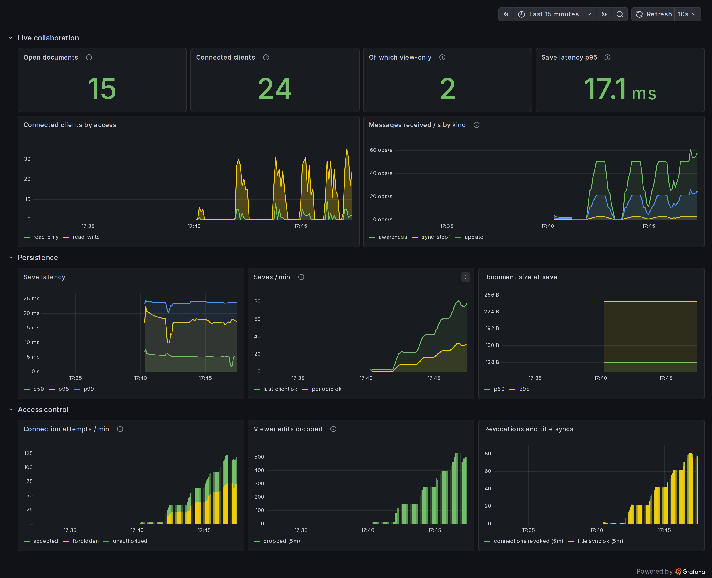

# Mycelium Notes

[](https://github.com/Sysex89/very_yum/actions/workflows/ci.yml)

A self-hosted note-taking app with real-time collaborative editing: several people in the same note, live cursors, no conflicts.



## Features

- **Real-time collaboration**: several people edit the same note at once, with live cursors. Built on Yjs CRDTs, so concurrent edits merge without conflicts and survive reconnects.
- **Sharing**: invite users to a note as viewer or editor, see what's been shared with you, and revoke access.
- **Accounts**: GitHub OAuth or email/password (Argon2), cookie sessions, profile editing, data export and account deletion.
- **8 languages**, including right-to-left Arabic, translated in both the UI and API error messages.
- **Observability**: Prometheus metrics from the app services, nginx and Postgres, with pre-built Grafana dashboards.
- **Server-side rendering** with Nuxt, plus light/dark themes.

## Architecture



Design decisions worth calling out:

- **Authentication happens once, at the edge.** nginx gates every protected route with an `auth_request` sub-request to the auth service, then injects the verified `X-User-Id` header (overwriting anything the client sent). Downstream services contain no session logic.
- **Document content is a CRDT, metadata is relational.** The `notes` service owns titles, ownership and sharing as ordinary rows. The `editor` service keeps one in-memory Yjs document per note, relays updates over WebSockets, and persists the binary state. On shutdown it closes every socket with code 1012 (service restart), so clients reconnect to the next instance, and saves every open document first. A restart takes under a second instead of Docker's 10 s timeout.
- **Rust on the hot paths.** Note CRUD and WebSocket sync are written in Rust (Axum, sqlx, yrs) for low overhead. Auth is TypeScript (Fastify + Drizzle).
- **Each service owns its data.** Auth and notes live in separate logical databases and reference each other only by user ID, so account deletion explicitly calls the notes service to remove a user's notes.

More detail: [database schema](DOCS/reference/database-schema.md), [monitoring architecture](DOCS/explanation/monitoring-architecture-prometheus-grafana.md), [collaboration internals](srcs/requirements/frontend/docs/dev/collab/overview.md).

## Observability

Every service is scraped by Prometheus and has a provisioned Grafana dashboard (`/grafana/`). The editor service, which carries all real-time traffic, reports open documents, connected clients by access level, message rates, save latency and document size, and access-control events such as rejected connections and edits dropped from view-only clients.



## Performance

A [load test](DOCS/explanation/load-test.md) drives real Yjs clients through nginx into one note and measures how long each keystroke takes to reach every other client. With **50 people all typing at once**, every keystroke arrives with a **p99 of 23 ms**. A **100-person room with 10 writers** has a p99 of 127 ms, and the editor stays under 35 MB of memory.

Before the test, the same 50-person room delivered only 36 % of keystrokes, up to 22 s late, and the editor grew to 2.9 GB. Two bugs caused it: every cursor move re-broadcast the whole room's cursors (O(N³) traffic), and per-client send queues had no limit. The write-up covers how they were found and fixed.

## Tech stack

| Layer | Technologies |
| --- | --- |
| Frontend | Nuxt 4, Vue 3, Pinia, Tailwind CSS, PrimeVue (Volt), TipTap, Yjs |
| Services | Rust (Axum, sqlx, yrs), TypeScript (Fastify 5, Drizzle ORM) |
| Data | PostgreSQL 16 |
| Infra | Docker Compose, nginx, Prometheus, Grafana, nginx/Postgres exporters |

## Running locally

### Quick demo

Requirements: Docker with Compose v2 and GNU Make.

```bash
make demo
```

This generates `srcs/.env` and `srcs/secrets/` (existing files are left untouched), starts the stack, and creates two users who share a note:

| User | Password |
| --- | --- |
| `alice` | `mycelium-demo` |
| `bob` | `mycelium-demo` |

Open **https://localhost:8443**, accept the self-signed certificate, and log in as each user in two different browsers (or a normal and a private window) to watch edits and cursors sync live. GitHub login is disabled in the demo.

`tests/e2e/screenshots/` has the scripts that regenerate the README screenshots against a running demo.

### Full setup (with GitHub login)

Requirements: Docker with Compose v2, GNU Make, and a [GitHub OAuth app](https://github.com/settings/developers) with the callback URL `https://localhost:8443/api/auth/login/github/callback`.

1. Create `srcs/.env`:

   ```env
   DB_USER=mycelium
   DB_PASSWORD=change-me
   DB_NAME=mycelium
   AUTH_DB_USER=auth
   AUTH_DB_NAME=auth
   POSTGRES_ADDR=postgres
   NOTES_ADDR=http://notes:3003
   AUTH_PORT=3000
   GITHUB_CLIENT_ID=<your OAuth app client ID>
   GITHUB_CALLBACK_URL=https://localhost:8443/api/auth/login/github/callback
   WEBSITE_URL=https://localhost:8443
   # UID=1000  GID=1000   # optional, for `make dev` file permissions
   ```

2. Create the secrets (one value per file):

   ```bash
   cp -r srcs/secrets.example srcs/secrets
   # then edit: auth_db_password, github_client_secret, session_secret_key,
   #            grafana_admin_user, grafana_admin_password, monitoring_db_password
   ```

3. Start it:

   ```bash
   make up
   ```

   Open **https://localhost:8443** and accept the self-signed certificate warning. Grafana is at `/grafana/`.

| Command | What it does |
| --- | --- |
| `make up` / `make live` | Build and start (detached / foreground) |
| `make dev` | Dev mode: frontend and auth source bind-mounted with hot reload |
| `make rebuild service=<name>` | Rebuild and restart one service |
| `make logs service=<name>` | Follow logs |
| `make down` | Stop, and clear `node_modules` / Nuxt cache volumes |
| `make fclean` | **Destructive.** Also deletes all database volumes |

### Tests

```bash
make e2e    # Playwright end-to-end tests against the running demo stack
make load   # collaboration load test (2 to 50 simultaneous editors), see DOCS/explanation/load-test.md
```

The end-to-end suite covers live sync between two users, persistence, title sync, edits surviving an editor restart, nginx's authentication gate (including ignoring a spoofed `X-User-Id`), share access and revocation. CI also runs the auth integration tests, Rust lints, the frontend build and config checks on every push.

Troubleshooting stale volumes and file permissions: [README_DEV.md](README_DEV.md).

## Credits

Mycelium Notes was built at 42 Berlin as a team project by **Ahmed Diler**, **Maarten Hoff**, **Masha Yakovenko**, **Grace Mullin** and **Pavlos Vasilantonakis**, with contributions from others listed in the commit history. The original repository is [MySeaLeeOom/basic_structure](https://github.com/MySeaLeeOom/basic_structure); the original project write-up is preserved in [DOCS/42-origins.md](DOCS/42-origins.md).

This fork is maintained by Pavlos Vasilantonakis.
