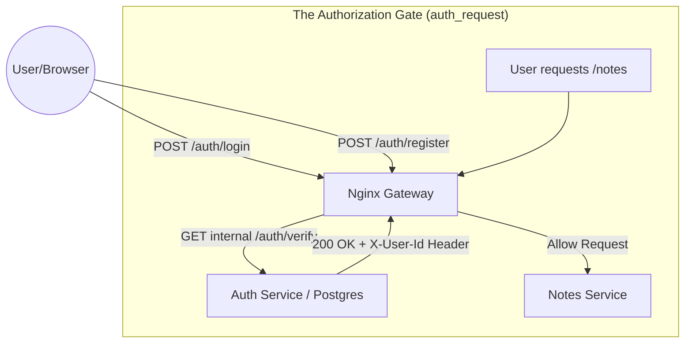
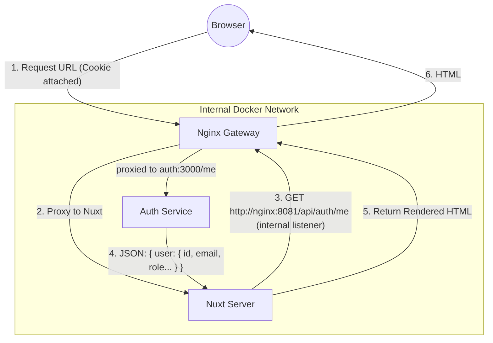

# Auth Service

An ultra-efficient Authentication service built with Fastify, TypeScript, and Drizzle ORM. It handles multi-strategy authentication (Local + GitHub OAuth2) and session management.

---
## Database migrations

The schema lives in [src/db/schema.ts](src/db/schema.ts). After changing it, run `pnpm db:generate` inside the auth container to write a new SQL migration into `drizzle/`, and commit both. Migrations are applied automatically when the server starts. Full walkthrough: [Update the auth database schema](../../../DOCS/howto/auth-new-migration-howto.md).

For a change to row data rather than structure, generate an empty migration with `pnpm drizzle-kit generate --custom` and write the SQL by hand, for example:
`UPDATE accounts SET provider_account_id = user_id::text WHERE provider = 'local';`

---

## Architectural Decisions

We follow a strict Separation of Concerns to ensure the code is both robust and testable (using Vitest and Fastify's `inject()`).

### 1. App Creation vs. Service Launch
To test a server without actually binding to a network port (which is slow and port-conflicts), we split the logic:
- [src/app.ts](src/app.ts) (The Recipe): Defines all routes, plugins (OAuth, Cookies), and database decorators. It returns a FastifyInstance.
- [src/index.ts](src/index.ts) (The Launcher): Loads environment variables/secrets (`loadConfig`), builds the server using the "recipe," and calls `server.listen()`.

### 2. Testing Isolation
In [src/tests/auth.test.ts](src/tests/auth.test.ts), we use the "recipe" `buildServer()` to create a temporary instance. This allows us to inject requests directly into the application logic using Fastify's `.inject()` method, bypassing the need for a real Nginx or network connection during tests.

---

## Features

- Multi-Strategy Auth: 
    - Local: Argon2 password hashing (slow/secure by design).
    - GitHub OAuth2: Dynamic callback construction using request headers.
- Session Management: signed `session_id` cookie (@fastify/cookie) holding a session token stored in the `sessions` table.
- Metrics: Prometheus counters and a histogram on `GET /metrics` (see `DOCS/reference/application-and-infrastructure-metrics.md`).
- Database: Drizzle ORM targeting PostgreSQL.
- Validation: Schema-based validation using TypeBox for every route.

---

## Endpoints & Wiring Guide

When configuring Nginx or other services, it helps to visualize how the Auth service fits into the mesh.

### Service Flow Diagram

### SSR Data Fetching Flow (Server-Side)

When the user first loads the page (Hard Refresh), Nuxt needs to know who they are *before* rendering the HTML.



---

## The "Thin Gate" Protocol

We distinguish between **Access** (is the door open?) and **Identity** (who is walking through?).

| Endpoint | Logic Type | Returns | Use Case |
| :--- | :--- | :--- | :--- |
| `GET /verify` | **Thin Gate** | `X-User-Id` header + `{ authenticated, userId, ... }` | Nginx `auth_request` / Fast Auth Checks. No DB Joins. |
| `GET /me` | **Thick Check** | Full `User` Object | Frontend Profile rendering / Admin Role checks. |

---

### Endpoint Reference

These are the routes exposed by the AUTH container on port `3000`.

| Method | Endpoint | Purpose | Wiring Context |
| :--- | :--- | :--- | :--- |
| **GET** | `/verify` | **Checks session cookie.** <br> **Status:** `200 OK` or `401`. <br> **Headers:** Sets `X-User-Id` for Nginx. | Used by Nginx `auth_request` directive. Fast session lookup. |
| **GET** | `/me` | **The Profile Identity.** <br> **Status:** `200 OK`. <br> **Body:** `{ authenticated: true, user: { id, loginName, email, role, ... } }`. | Used by Frontend (SSR & Client) to fetch full User information. |
| **GET** | `/resolve` | **User Identity Resolution.** <br> **Accepts:** `?identifier=<email_or_login>` <br> **Returns:** `{ user: { id, loginName, imageURL } }` | Used by Share Flow to convert human identity to UUID. |
| **POST** | `/logout` | **Clears session cookie.** | Called by frontend button. |
| **POST** | `/login` | Accepts `{ identifier, password }`. Sets cookie. | Public form submission. |
| **POST** | `/register` | Accepts `{ loginName, email, password }`. Sets cookie. | Public form submission. |
| **GET** | `/login/github` | Redirects browser to GitHub. | Link from "Login with GitHub" button. |
| **GET** | `/login/github/callback` | Exchanges the OAuth code, finds or creates the user, sets the cookie, redirects to `WEBSITE_URL`. | GitHub redirects here (`GITHUB_CALLBACK_URL`). |
| **GET** | `/` | Status: `{ service: "auth", status: "running" }`. | Health check. |
| **GET** | `/ping` | `pong`. | Health check. |
| **GET** | `/metrics` | Prometheus metrics. | Scraped by Prometheus; not routed by nginx. |
| **GET** | `/users` | Returns all registered users (`id`, `loginName`, `imageURL`). | Used by frontend share dialog. |
| **PATCH** | `/change-login` | Updates `loginName`. Accepts `{ loginName }`. | Profile settings. |
| **PATCH** | `/change-email` | Updates `email`. Accepts `{ email }`. | Profile settings. |
| **PATCH** | `/change-image` | Sets or clears profile picture URL. Accepts `{ imageURL }`. | Profile settings. |
| **POST** | `/change-password` | Updates or creates local password. Accepts `{ oldPassword, newPassword }`. | Profile settings. |
| **GET** | `/export-data` | GDPR-style export of user profile, accounts, sessions, and notes. | Profile settings. |
| **DELETE** | `/delete-account` | Deletes user, their notes, and linked data. Clears session cookie. | Profile settings. |

---

## Development Workflow

### 1. Development (With Docker)
`make dev` (from the repository root) runs auth from `Dockerfile.dev`: the source is bind-mounted and `tsx watch` reloads on save.

### 2. Running Tests
Integration tests against the dev database; they apply migrations and clean up after themselves. The production image has no dev dependencies, so use the dev stack:
```bash
docker compose -f srcs/docker-compose-dev.yml exec auth pnpm test --run
```
What each test covers: [src/tests/TESTING.md](src/tests/TESTING.md). CI runs the same suite against a throwaway Postgres.

---

## Production Deployment

We use a Multi-Stage Dockerfile to minimize the final image size and exclude development tools like typescript or vitest.

### The Production Build Process
1. Builder Stage: Compiles .ts files into the `dist/` folder using tsc.
2. Runner Stage: Only copies the compiled `dist/`, the production node_modules (no devDeps), and the drizzle migrations.

### Production Runtime
In a production environment, use the production Dockerfile (rather than Dockerfile.dev) to ensure the service runs the compiled JavaScript via the standard node runtime. This is typically managed via the overarching docker-compose configuration.

---

## Project Structure

- [src/app.ts](src/app.ts): Core application assembly.
- [src/index.ts](src/index.ts): Entry point (Config loading + Process handling).
- [src/db/](src/db/): Database schema definitions and connection pooling.
- [src/routes/](src/routes/): Route handlers split by domain (Auth, Sessions, User).
- [src/lib/](src/lib/): Helpers for sessions (create, verify, revoke) and accounts.
- [drizzle/](drizzle/): Generated SQL migrations and their snapshots.
- [src/tests/](src/tests/): Integration and unit tests.
